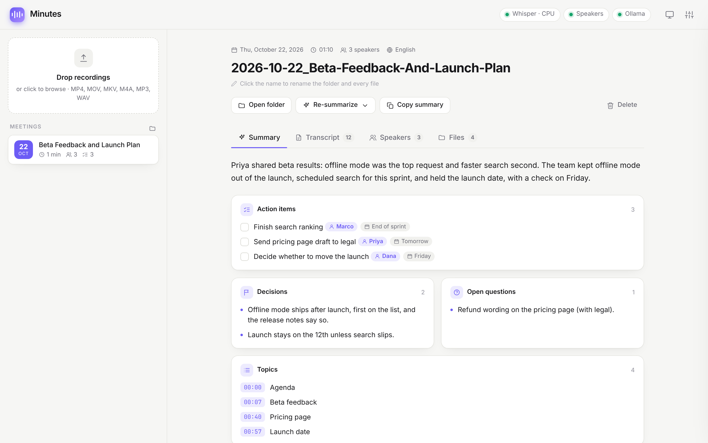

# Minutes

[](https://github.com/jrwray/minutes/actions/workflows/ci.yml)

A local meeting transcriber for Windows. Drop in a recording and get back a timestamped transcript with speaker names, a meeting summary, and neatly named files. Transcription and speaker detection run entirely on your machine, with no upload sites and no command-line juggling.

```
meeting.mp4 → transcript (Whisper) → speakers (pyannote) → summary (Ollama or Claude) → named folder
```

<picture>
  <source media="(prefers-color-scheme: dark)" srcset="docs/screenshot-dark.png">
  
</picture>

<sub>Shown with the sample meeting from <code>tools/demo.py</code>.</sub>

## Features

- **Drag-and-drop web UI** on `localhost`, with a queue, live progress and time-remaining estimates, plus a live preview of the text as it's transcribed
- **Accurate transcription** with [faster-whisper](https://github.com/SYSTRAN/faster-whisper) `large-v3-turbo`. It skips silence and takes a custom vocabulary for names and jargon
- **CPU or GPU.** On first run the app asks where transcription should run and shows the detected hardware. NVIDIA GPUs run Whisper in float16, and if the GPU can't start, the job falls back to the CPU and says why
- **Speaker detection** with [pyannote](https://github.com/pyannote/pyannote-audio). Rename "Speaker 1" to a real name and the transcript, summary and files all update, including summaries still being generated
- **Meeting summary** with an overview, decisions, action items (owner and due date), open questions and clickable topic timestamps
  - **Ollama** (fully local) or **Claude** (Anthropic API), switchable per meeting
- **Sensible file names**, such as `2026-10-14_Q4-Budget-Review/`, using the recording date plus an AI-generated title. Edit the name in the UI and the folder and every file are renamed to match
- Outputs `_transcript.txt`, `.srt` subtitles, `_summary.md`, full `.json`, and an optional 16 kHz WAV
- **Delete** a meeting from the UI, which moves its folder to the Recycle Bin so it can be restored
- **Safe by default:** crash-safe saves, plain-language errors for unreadable files, and an API other websites can't reach (see [Security](#security))
- Light and dark themes, keyboard friendly

## Setup (Windows)

1. Install [Python](https://www.python.org/downloads/) 3.11+ and then [uv](https://docs.astral.sh/uv/): `pip install uv`
2. Clone this repo and run `uv sync` inside it. This installs everything, ffmpeg included, so you don't need a separate install.
3. Double-click **`Start.bat`**. The app opens in your browser at http://127.0.0.1:7860 and asks whether to transcribe on the CPU or GPU.

The Whisper model (~1.6 GB) downloads automatically on first use, and after that transcription works offline.

### Optional: NVIDIA GPU

1. Install a current [NVIDIA driver](https://www.nvidia.com/drivers) (CUDA 12 capable)
2. Run `uv sync --extra gpu` to add cuBLAS (~500 MB; cuDNN is already included)
3. Pick **GPU** in the first-run popup, or under **Settings → Transcription → Run on**

The GPU option is disabled when no NVIDIA GPU or no GPU libraries are found, and the settings panel explains which. Only transcription uses the GPU for now; speaker detection stays on the CPU. GPU support is new: detection and the CPU fallback are tested, but it hasn't yet been benchmarked on NVIDIA hardware, so reports are welcome.

### Optional: speaker detection

1. Create a free [Hugging Face](https://huggingface.co) account
2. Accept the terms on [pyannote/speaker-diarization-3.1](https://huggingface.co/pyannote/speaker-diarization-3.1) and [pyannote/segmentation-3.0](https://huggingface.co/pyannote/segmentation-3.0)
3. Create a read token at <https://huggingface.co/settings/tokens> and paste it into **Settings → Speakers**

### Optional: summaries

- **Local:** install [Ollama](https://ollama.com/download), then `ollama pull qwen2.5:7b`. Any chat model you have pulled can be picked in Settings.
- **Claude:** paste an [Anthropic API key](https://console.anthropic.com/) into **Settings → Summary**. Only the transcript text is sent to Anthropic, never the audio. If your key isn't scoped to a workspace, also fill in **Workspace ID**.

Keys are stored only in `data/settings.json`, which git ignores.

## Performance

These timings were measured on CPU only (Ryzen 7 7730U, a laptop chip), and the 1-hour column is extrapolated from them.

| Step | 9-min recording (measured) | 1-hour meeting (est.) |
| --- | --- | --- |
| Transcribe (`large-v3-turbo` int8) | 4 min | ~28 min |
| Speakers (pyannote 3.1) | 7.5 min | ~50 min |
| Summary (Ollama `qwen2.5:7b`) | 3 min | ~10–15 min |
| Summary (Claude Opus 5.5) | not timed separately (a whole 1-min clip took 65 s end to end) | typically under a minute |

Speaker detection is the slow step on CPU. Turn it off in Settings when you only need the text, and use a GPU to speed up transcription.

## Project layout

```
minutes/
  transcribe.py   faster-whisper wrapper (CPU/GPU, falls back to CPU)
  device.py       CPU/GPU detection
  diarize.py      pyannote + word-level speaker alignment
  summarize.py    Ollama / Claude summaries (structured JSON)
  export.py       naming, crash-safe .txt/.srt/.md/.json writers
  jobs.py         single-worker queue
  server.py       FastAPI routes + request protection
static/           UI (vanilla HTML/CSS/JS, no build step)
tests/            pytest suite (fake engines, no models needed)
tools/demo.py     UI demo with a sample meeting (no models needed)
Start.bat         launcher
```

## Development

```
uv sync
uv run pytest
```

To try the interface without downloading any models, run the demo. It starts on port 7861 with a sample meeting and stand-in engines, and deletes its temp folder on exit:

```
uv run python tools/demo.py
```

The tests use fake transcription/speaker/summary engines and a temporary output folder, so they run in seconds and never touch your real meetings or settings. CI runs them on Windows for every push.

## Security

Minutes only listens on `127.0.0.1`, but any web page open in your browser can still send requests to it, so the API:

- answers only requests addressed to `127.0.0.1` or `localhost`, which blocks DNS-rebinding tricks
- requires state-changing browser requests to come from the Minutes page itself and carry an `X-Minutes: 1` header, which other sites can't add

Scripts aren't browsers, so they can call the API directly:

```
curl -F "file=@meeting.mp4" http://127.0.0.1:7860/api/upload
```

## License

MIT
